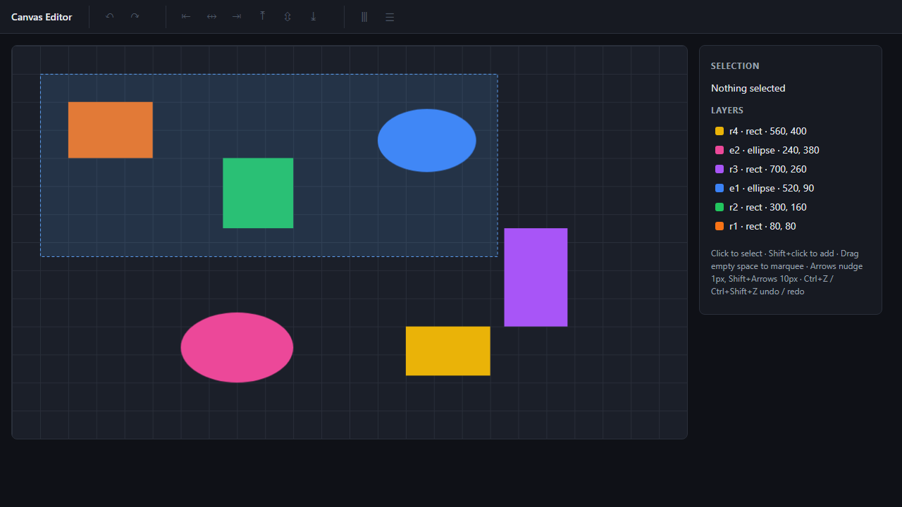
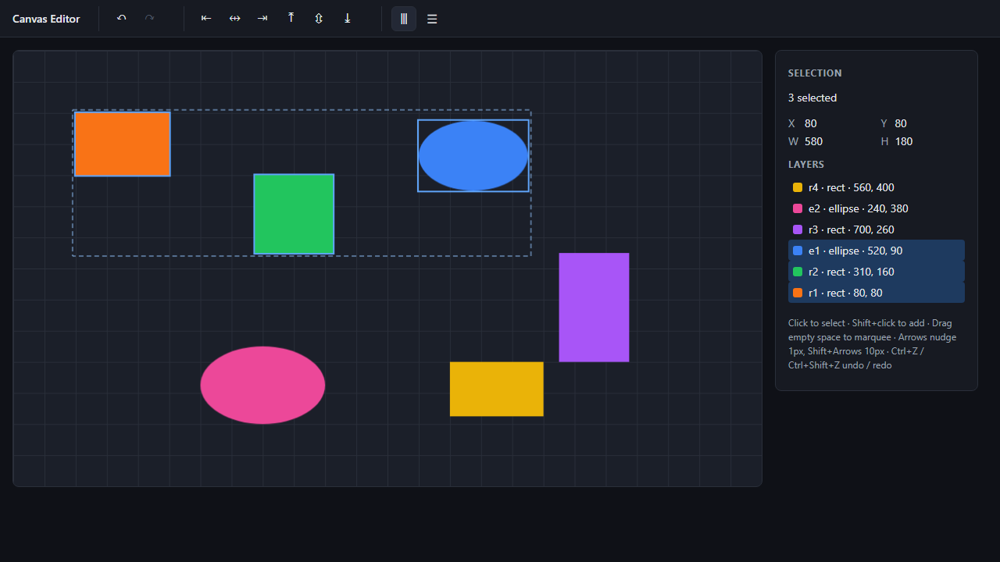

<div align="center">


</div>

---

## Hi, I'm Byte Forge 👋

Frontend engineer based in Madrid. I build interactive interfaces in **React + TypeScript** — editors, dashboards, drag-and-drop, things that draw on a `<canvas>` — and I care as much about *proving* a UI behaves correctly as about building it.

What I'm good at:

- **Complex interactions** — selection models, pointer gestures, keyboard shortcuts, undo/redo, state that stays consistent under rapid input.
- **Canvas & SVG** — hit-testing, bounding boxes, alignment/distribution maths, DPR-correct rendering.
- **Making behaviour verifiable** — writing specs where every rule maps to a test, so a reviewer can say *pass* or *fail* without guessing.
- **Reading other people's code** — modifying and debugging real applications, not just greenfield demos.

---

## 📌 Featured

### [`canvas-task-alignment`](https://github.com/byteforge9190/canvas-task-alignment)

A worked example of how I specify and grade frontend work. A small React/TypeScript canvas editor, plus:

<div align="center">
<table>
<tr>
<td align="center"><br/><sub>Step 1 — marquee selection in progress</sub></td>
<td align="center"><br/><sub>Step 2 — align / distribute toolbar applied</sub></td>
</tr>
</table>
</div>


- **`TASK.md`** — a three-step task (marquee selection → align/distribute toolbar → keyboard nudge with undo) written from screenshots of the finished feature, with a precise state contract and documented edge cases.
- **Objective success criteria** — 12 unit tests on the geometry and 16 Playwright tests that drive the real UI with pointer and keyboard events and assert on application state, not pixels.
- **`VERIFICATION.md`** — a ten-minute reviewer procedure with integrity checks and explicit accept / reject rules.
- **`main`** is the starter the implementer receives (tests fail by design); **`solution`** is the reference implementation (all green).

```bash
git clone https://github.com/byteforge9190/canvas-task-alignment && cd canvas-task-alignment
npm ci && npx playwright install chromium
git checkout solution && npm test        # 12 unit + 16 e2e pass
git diff main solution --stat            # exactly what the task asks for
```

<!-- Add more entries here as real work lands: open-source PRs, other task repos. Only link things you actually built. -->

---

## 🧰 Stack

| Area | Daily use |
|---|---|
| UI | React 19, TypeScript, Vite, Zustand, Tailwind |
| Graphics | Canvas 2D, SVG, pointer events, requestAnimationFrame |
| Testing | Playwright, Vitest, React Testing Library |
| Backend I'm comfortable in | Node.js, Express, MongoDB, PostgreSQL |
| Tooling | Git, GitHub Actions, ESLint/oxlint, Docker |

---

## 🧪 How I think about UI work

> "It looks right" is where the work starts, not where it ends.

- Write the expected behaviour down **before** coding — including what should *not* happen (no history entry on marquee, no nudge with empty selection).
- Prefer tests that assert on **state** over screenshots; keep the few pixel checks explicit and manual.
- Treat ambiguity as a defect in the spec: if two reasonable implementations would disagree, fix the spec, don't grade the guess.
- Document the traps (floating-point drift, edge-contact hit-testing) instead of letting people fall into them.

---

## 🤝 Reach me

<div align="center">

<a href="https://github.com/byteforge9190/canvas-task-alignment/issues"></a>

<br/><br/>
<sub>Open to remote frontend / UI engineering work and contract task-design roles. The quickest way to reach me is an issue or discussion on any of my repos.</sub>

</div>


